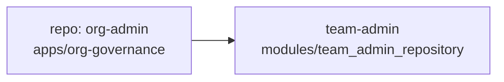

# Skill: Crear y validar diagramas Mermaid

Propósito
- Normalizar cómo se crean, validan y publican diagramas Mermaid en este entorno de trabajo.
- Proveer comandos, herramientas y ejemplos de CI para automatizar render y validación.

Ámbito
- Diagramas Mermaid (.mmd o bloques ```mermaid``` en .md)
- Render a SVG/PNG para incluir en README o docs
- Validación de sintaxis y chequeos básicos en CI

Herramientas recomendadas
- mermaid-cli (@mermaid-js/mermaid-cli) — render CLI (mmdc). Uso via npx o instalación global.
- mermaid.live — editor web para preview rápido y debugging interactivo.
- VS Code extension: "Markdown Preview Mermaid Support" o "vscode-mermaid-preview" para preview local.
- GitHub Actions: usar `shivammathur/setup-node` + `npm` + `@mermaid-js/mermaid-cli` o usar contenedor con `mmdc` instalado.

Comandos básicos (CLI)

Instalación global (opcional):

```bash
npm install -g @mermaid-js/mermaid-cli
```

Renderizar un archivo .mmd a SVG:

```bash
mmdc -i diagrams/architecture.mmd -o docs/assets/architecture.svg
# o con npx (no instalar globalmente)
npx @mermaid-js/mermaid-cli -i diagrams/architecture.mmd -o docs/assets/architecture.svg
```

Renderizar bloques en un .md
- Extrae el bloque Mermaid a un .mmd y procesa con `mmdc`, o usa herramientas que soporten extraer bloques automatic.

Validación
- mermaid-cli falla al renderizar si la sintaxis es inválida y retornará código de salida !=0, por lo que usarlo como validador en CI es suficiente.
- Para validaciones adicionales:
  - comprobar que no hay caracteres no-ASCII en códigos de color (hex) ni caracteres de control en el texto de nodos.
  - revisar que los nodos con paréntesis o símbolos conflictivos estén entrecomillados o usen backticks/Markdown strings.

Guía de sintaxis práctica (resumen)
- Para etiquetas multilínea o texto con paréntesis/<>: usar comillas dobles y/o Markdown strings con `htmlLabels: false`.
- Para saltos de línea en etiquetas: usar `<br>` dentro de la cadena, o usar las comillas con texto multilínea (según versión de mermaid).
- Para clases y estilos: usar hex ASCII puros, p.ej. `stroke:#2b8f2b` (sin caracteres no ASCII).

Decisión: README embebido vs .mmd separado
- Si el diagrama es pequeño y estable: renderizar a `docs/assets/diagram.svg` y referenciar desde `README.md` con ``.
- Si el diagrama es grande o necesita edición frecuente: mantener `diagrams/*.mmd` fuente y renderizar SVG en CI para comprobar la sintaxis; publicar ambos (source + rendered SVG). En README referenciar el SVG.

Recomendación de estructura de repositorio

- /docs/diagrams/*.mmd  # fuentes editables
- /docs/assets/*.svg    # renderizados desde CI
- README.md             # referencia a docs/assets/*.svg (no embed raw mermaid)

Ejemplo de GitHub Action (renderizar .mmd a svg en push/PR)

```yaml
name: Render Mermaid diagrams
on:
  push:
    paths:
      - 'docs/diagrams/**'
  pull_request:
    paths:
      - 'docs/diagrams/**'

jobs:
  render:
    runs-on: ubuntu-latest
    steps:
      - uses: actions/checkout@v6
      - name: Setup Node
        uses: actions/setup-node@v6
        with:
          node-version: '18'
      - name: Install mermaid-cli
        run: npm install -g @mermaid-js/mermaid-cli
      - name: Render diagrams
        run: |
          mkdir -p docs/assets
          for f in docs/diagrams/*.mmd; do
            fname=$(basename "$f" .mmd)
            mmdc -i "$f" -o "docs/assets/${fname}.svg" || exit 1
          done
      - name: Commit rendered diagrams
        run: |
          git config user.name "mermaid-bot"
          git config user.email "noreply@example.com"
          git add docs/assets/*.svg
          git commit -m "chore: render mermaid diagrams" || echo "no changes"
          git push || echo "push failed (check permissions)"
```

Notas sobre CI commit
- Recomiendo que el job solo cree un artefacto (attach SVGs) y no haga push automático a menos que uses un bot account con permisos. Alternativamente, publicar SVGs en artefactos de CI o en una branch `generated/`.

Validación en local (rápida)

```bash
# desde la raíz del repo
mkdir -p docs/assets
npx @mermaid-js/mermaid-cli -i docs/diagrams/architecture.mmd -o docs/assets/architecture.svg
```

Chequeos adicionales (pre-commit)
- Añadir hook pre-commit que llame a `npx @mermaid-js/mermaid-cli -i` sobre los archivos modificados y falle si hay errores.

Plantilla de README snippet para incluir diagramas

```markdown


Fuente: `docs/diagrams/architecture.mmd` — editar el `.mmd` y abrir PR con cambios; CI renderizará y el resultado se mostrará en el README.
```

Checklist de la skill (qué hacer cuando se crea o actualiza un diagrama)
1. Editar `docs/diagrams/*.mmd` o el bloque en `.md` y extraer a `.mmd` si procede.
2. Validar local con `npx @mermaid-js/mermaid-cli -i file.mmd -o /dev/null` (o generar SVG).
3. Abrir PR con cambios a `.mmd` (y opcionalmente al SVG si lo mantienes versionado).
4. CI ejecuta render; revisar artefactos/PR status.
5. Merge cuando CI pase y revisión humana confirme diseño.

Ejemplo rápido de fragmentos mermaid seguros



Fin.
