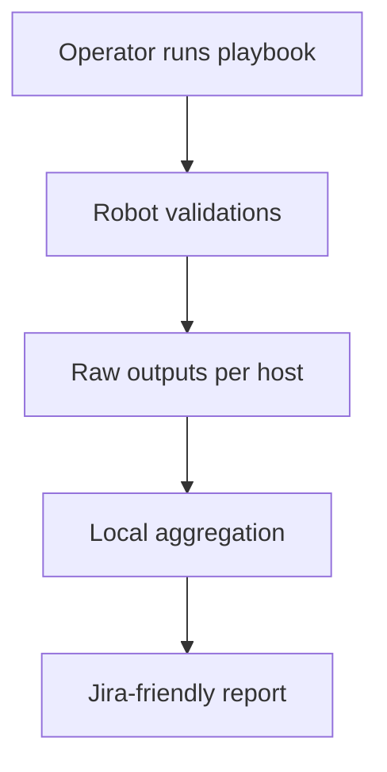
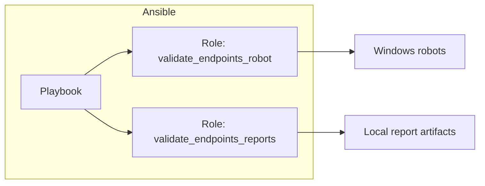

# Visual PR Description

## When to Use
- You already extracted “what changed” from a PR and need to **rewrite or propose** a PR description.
- The description must be **visual** and easy to scan, with diagrams.

## Constraints
- Don’t include line counts, file counts, commit counts, or any numbers likely to change.
- Don’t guess test results.
- Don’t reference local filesystem paths (use repo-relative paths like `src/` or `playbooks/` instead of `/home/user/repo/src/` or `C:\repo\src\` or `~/repo/src/`).

## Recommended Output Structure (Markdown)
1. **Executive summary** (2–5 bullets)
2. **Change map** (table: Area → Paths → Intent)
3. **Behavioral change** (Before/After)
4. **How it fits** (existing architecture + why this place)
5. **Impact** (Ops/Runtime/DevEx)
6. **Risks & mitigations**
7. **Verification** (CI + manual steps)
8. **Follow-ups** (optional)

## Diagrams (Mermaid)
Use at least one diagram. Pick the one that best matches the change.

### A) High-level flow

### B) Component map

## Template
Use (or adapt) this template file:
- [pr-description-template](./assets/pr-description-template.md)
