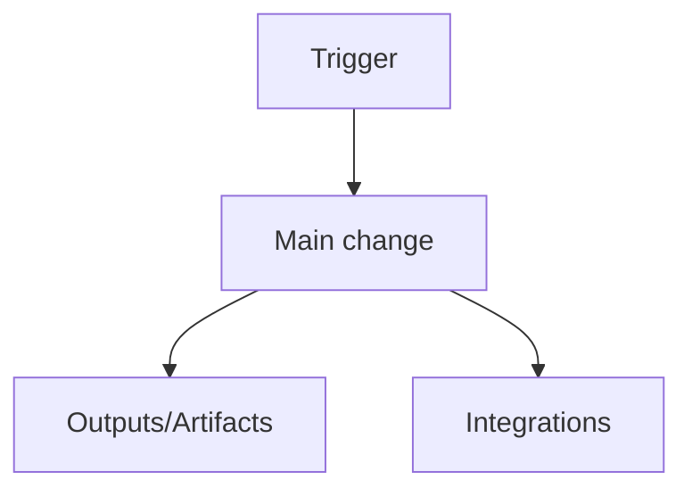

## 🧾 Summary
- **What**: <One sentence summary of the change>
- **Why**: <Reason / problem being solved>
- **Scope**: <Areas touched, described qualitatively>

## 🗺️ Change map
| Area | Paths (examples) | Intent |
|---|---|---|
| Ansible roles | `ansible/roles/...` | <What changed and why> |
| Playbooks | `ansible/*.yaml` | <What changed and why> |
| Docs | `README.md`, `docs/...` | <What changed and why> |

## 🔁 Behavior change
**Before**
- <Bullet>

**After**
- <Bullet>

## 🧩 How this fits
- <How it integrates with existing roles/tasks/modules>
- <Why these files/locations are the right place>

## 📈 Impact
- **Runtime/Ops**: <e.g., new vars, new output artifacts, new prerequisites>
- **DevEx/Maintenance**: <e.g., improved idempotency, clearer structure>

## ⚠️ Risks & mitigations
- Risk: <...>
  - Mitigation: <...>

## ✅ Verification
- CI/Checks: <List check names + status if verified>
- Manual: <Short reproducible steps>

## 🧭 Diagrams

