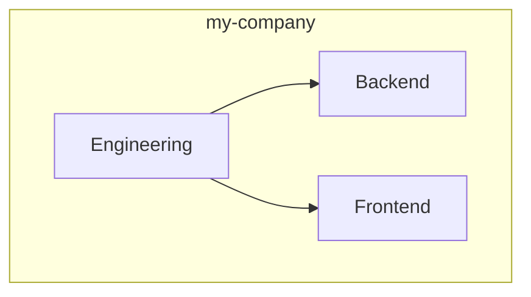

# Team Hierarchy Viewer

## When to Use

- User asks about team hierarchy or structure in a GitHub organization.
- User wants to see which teams are children of other teams.
- User requests a visual diagram of team relationships.
- User needs to audit nested vs flat teams.
- User mentions team hierarchy, parent teams, or team structure.

## How It Works

Queries the GitHub REST API directly via `gh` CLI. No files needed — just a live org/enterprise and authenticated access.

Supports:
- **GitHub.com** — default, no extra flags
- **GitHub Enterprise Server** — pass `--ghes-url`
- **Single organization** — `--org`
- **Entire enterprise** — `--enterprise` (fetches all orgs automatically)

## Usage

### Single Organization

```bash
python3 team_hierarchy.py --org ORG_NAME [OPTIONS]
```

### Entire Enterprise

```bash
python3 team_hierarchy.py --enterprise ENTERPRISE_SLUG [OPTIONS]
```

| Option | Description | Default |
|--------|-------------|---------|
| `--org` | Organization login *(mutually exclusive with --enterprise)* | — |
| `--enterprise` | Enterprise slug — fetches all orgs *(mutually exclusive with --org)* | — |
| `--ghes-url` | GHES base URL (e.g. `https://<ghes-url>`) | `https://github.com` |
| `--output` | Write to file instead of stdout | stdout |
| `--format` | `table`, `mermaid`, or `both` | `both` |

## Examples

### GitHub.com org

```bash
python3 team_hierarchy.py --org my-company
```

### GHES org

```bash
python3 team_hierarchy.py --org my-team --ghes-url https://<ghes-url>
```

### Entire enterprise (GHES)

```bash
python3 team_hierarchy.py --enterprise my-enterprise --ghes-url https://<ghes-url> --output enterprise-teams.md
```

### Entire enterprise (GitHub.com)

```bash
python3 team_hierarchy.py --enterprise my-enterprise --output enterprise-teams.md
```

### Save single org to file

```bash
python3 team_hierarchy.py --org my-company --output team-hierarchy.md
```

## Output

A Markdown file with three sections:

### 1. Summary

| Metric | Count |
|--------|-------|
| Total teams | 38 |
| Root teams | 17 |
| Nested teams | 21 |
| Total members | 150 |

### 2. Table

| Team | Description | Privacy | Members | Parent | Link |
|------|-------------|---------|---------|--------|------|
| **Engineering** | Main engineering team | closed | 45 | - | [↗](https://github.com/org/teams/engineering) |
| ↳ Backend | Backend squad | closed | 12 | Engineering | [↗](...) |
| ↳ Frontend | Frontend squad | closed | 8 | Engineering | [↗](...) |

### 3. Mermaid Diagram



## Requirements

- `gh` CLI installed and authenticated (`gh auth login`)
- `python3` with standard library (no external deps)
- API access to the target org (membership or admin)

## Notes

- Teams with a `parent` field in the API response are shown as nested (↳) under their parent.
- The diagram uses Mermaid `graph TD` with clickable `click` directives.
- Links point to the team's discussions page (works for both github.com and GHES).
- **Enterprise fallback**: If the enterprise management API is not available (e.g. GHES < 3.12), the tool falls back to listing all organizations the authenticated user has access to.
